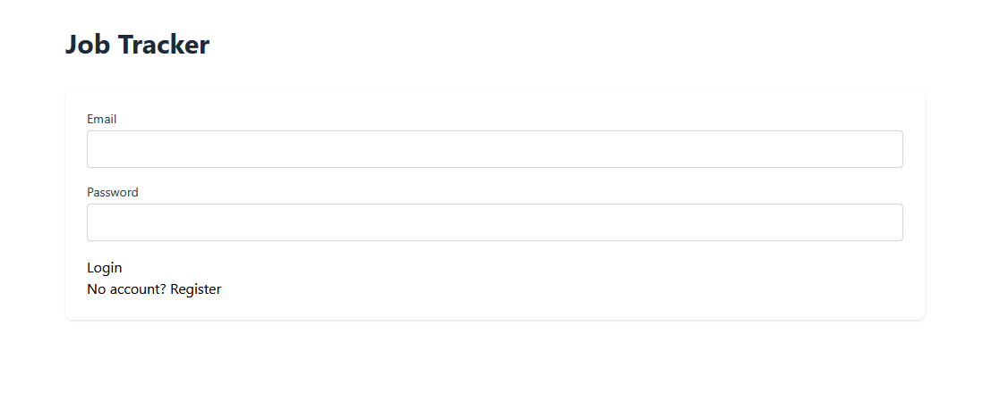
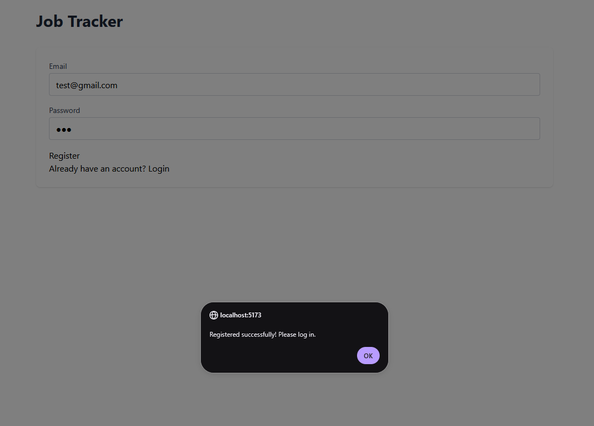
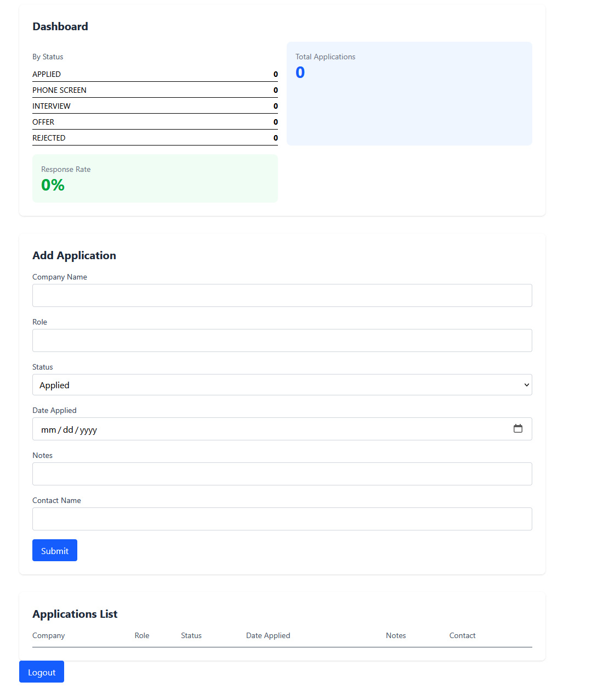
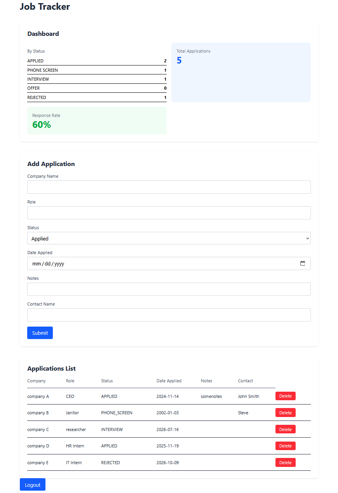

# Job Application Tracker

A full-stack web app for tracking job applications from first submission to final outcome. Users sign up, log in, and manage their own applications through a dashboard.

**Built:** Jul 2026 – Sep 2026






## Features

- User registration and login with JWT-based authentication
- Dashboard with an application table and add/edit forms
- Track each application through five stages: `APPLIED`, `PHONE_SCREEN`, `INTERVIEW`, `OFFER`, `REJECTED`
- [Add anything else it does: filtering, search, status counts, delete, etc.]

## Tech Stack

| Layer | Technology |
|---|---|
| Frontend | React, Vite |
| Backend | Java 21, Spring Boot 4.1, Spring Web MVC |
| Security | Spring Security, JWT (jjwt) with a custom request filter |
| Database | PostgreSQL via Spring Data JPA |
| Build | Maven, npm |

## Architecture

```
React (Vite)  --HTTP/JSON + JWT-->  Spring Boot REST API  --JPA-->  PostgreSQL
```

The backend follows a layered structure:

- `Controller`: handles HTTP requests (`AuthController`, `ApplicationController`)
- `Service`: business logic (`ApplicationService`)
- `Repository`: database access with Spring Data JPA (`ApplicationRepository`, `UserRepository`)
- `JwtFilter` / `JwtUtil` / `SecurityConfig`: validate the token on each request and protect the API

## Getting Started

### Prerequisites

- Java 21
- Maven (or use the included wrapper if present)
- Node.js 18+
- PostgreSQL

### 1. Database

Create a local database:

```sql
CREATE DATABASE jobtracker;
```

### 2. Backend

Set your configuration in `src/main/resources/application.properties` (or as environment variables):

```properties
spring.datasource.url=jdbc:postgresql://localhost:5432/jobtracker
spring.datasource.username=[your-db-user]
spring.datasource.password=[your-db-password]
[jwt secret property name]=[a-long-random-secret]
```

Then run:

```bash
mvn spring-boot:run
```

The API starts on `http://localhost:8080` by default.

### 3. Frontend

```bash
cd [frontend folder, if separate]
npm install
npm run dev
```

The app runs on `http://localhost:5173` by default. Make sure the backend's CORS settings in `SecurityConfig` allow this origin.

## API Overview

| Method | Endpoint | Description | Auth |
|---|---|---|---|
| POST | `[/api/auth/register]` | Create an account | No |
| POST | `[/api/auth/login]` | Log in and receive a JWT | No |
| GET | `[/api/applications]` | List your applications | Yes |
| POST | `[/api/applications]` | Add an application | Yes |
| PUT | `[/api/applications/{id}]` | Update an application | Yes |
| DELETE | `[/api/applications/{id}]` | Delete an application | Yes |

Authenticated requests send the token as `Authorization: Bearer <token>`.

## What I Learned

- Designing a stateless authentication flow with Spring Security and a custom JWT filter
- Modeling relational data and using Spring Data JPA with PostgreSQL
- Connecting a React frontend to a REST API and handling CORS between the two
- Deploying a full-stack app (it was hosted on Railway before I moved it to run locally)

## Future Improvements

- [Pick 2-3 you'd realistically want: tests, search/filter, Docker setup, notes or deadlines per application, free-tier cloud deployment]
